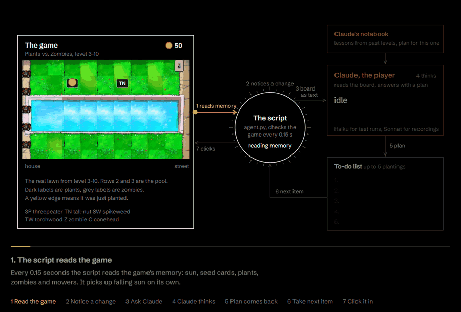

# PvZ Claude Player

Claude plays Plants vs. Zombies GOTY on Windows. It reads a text snapshot of the lawn and decides what to plant or shovel. A Python controller turns those decisions into clicks in the running game.

*One real decision from level 3-10. The script reads the game every 0.15 s and does all the clicking. Claude is only asked when something changes, and answers with a to-do list of up to five plantings.*

## How it works

1. **Read the lawn.** [`state.py`](state.py) reads the game process using build-specific offsets from [`offsets.py`](offsets.py). The snapshot includes sun, seed costs and recharge status, plant positions, zombies, lawn mowers, and the current wave. [`brains.py`](brains.py) turns that snapshot into text, with a grid Claude can use to choose cells.

The board also gives unranked legal planting cells using the executor's shared checks in `placement.py`. Packets with identical targets share one list, with funding and recharge kept in the seed table. Plant actions require a packet name and coordinates. Observation timestamps make clear that the board may change while the player thinks.
2. **Ask Claude for a plan.** Claude returns up to five actions as JSON and chooses whether to keep, append to, cancel IDs from, or replace its queue (at most 15 pending). The game keeps running while Claude thinks. Action IDs preserve unfinished moves and prevent completed IDs from being replayed by late answers. Ordinary threat calls retain a ten-second safety interval.
3. **Check and execute each move.** [`agent.py`](agent.py) checks queued actions against the live board. If Claude queues a Peashooter at 75 sun, for example, it waits until there is 100 sun and the seed has recharged. It checks graves, craters, aquatic plants, Lily Pads, Flower Pots, sleeping mushrooms, and upgrades. [`controller.py`](controller.py) uses terrain-specific click positions for five-row lawns, six-row pool boards, and the roof slope.
4. **Handle special levels.** Conveyor cards are free, single-use plants whose click positions move across the bank. Wall-nut Bowling limits launches to the first three columns. Vasebreaker exposes temporary seed packets and adds a vase-breaking action to Claude's plans. Scripted reflexes click zombies in Whack-a-Zombie and counter Zomboss fire and ice balls with the matching instant plant. Sun and coin collection are also scripted.

Vasebreaker uses the same player and queue as other levels. Its observations distinguish visible leafy plant vases (`vase(plant)`) from plain vases without decoding concealed contents. Free lawn packets show estimated time until expiry (roughly 15 seconds after landing at normal speed) and flashing/fading warnings. Observed vase breaks, packet appearances/disappearances, and new arrangements enter the action feedback and reflection timeline. Changes can request a new decision within the existing four-second minimum interval; the script does not choose which vase to open or require a particular opening order. The visible appearance offset was checked against the plain vases on live GOTY 4-5; green-vase decoding and packet timing have offline coverage in `test_vasebreaker.py` and still need a live visual check when those objects appear. Field definitions and lifetime follow the [public game reference](https://github.com/Patoke/re-plants-vs-zombies/tree/main/Lawn).
5. **Advance through Adventure.** A level ends after the game changes to a confirmed result screen. Consecutive-level mode navigates the title screen, rewards, Crazy Dave dialogue, plant selection, and the intervening Almanac, shop, shovel tutorial, and Zen Garden tutorial. It clears the old plan between boards and checks the next Adventure level number. It can retry losses up to a specified count and finishes at 5-10.

The board also gives unranked legal planting cells using the executor's shared checks in `placement.py`. Packets with identical targets share one list, with funding and recharge kept in the seed table. Plant actions require a packet name and coordinates. Observation timestamps make clear that the board may change while the player thinks.

The default run ends after one level. Consecutive play is enabled with `--levels N`, `--campaign`, or an absolute endpoint such as `--until-level 10`. The `--retries N` option controls loss retries. Add `--max-attempts N` to stop after N total attempts, counting both wins and losses across levels. Roof observations explain that straight projectiles fired from the slope can hit the roof before distant zombies; this fact is also given during plant selection. Row summaries count firing direction without claiming an unobstructed shot. The included `10 - AI plays consecutive levels.bat` chooses Haiku at low effort and allows two retries per level. Navigation has a timeout, and repeated player or board-reading errors stop the run.

Press **Ctrl+C anywhere on the desktop**, including while the game has focus, to stop the agent. The listener stops further controller input, cancels the current Claude Code player call, and pauses an active level. It also works during plant selection, planning, and between levels. Ordinary console Ctrl+C continues to work. The stop listener exists only while `agent.py` is running.

Menus and transitions use a deterministic bot and consume zero Claude decisions. It handles saved-game Continue dialogs and focus-loss pauses during intros. Claude is called for the loadout and board plans. Each confirmed result gets a local screenshot, allowing wins and failures to be reviewed after automatic transitions. [Live test results](TEST_RESULTS.md)

## What a run records

The local JSONL log records each board snapshot sent to Claude, its plan, which actions went through, and the level result. It also captures response times and token usage when available. The recording overlay shows Claude’s latest explanation and planned moves.

The player can choose up to three measurable planting objectives with its plan. Their completed counts, current presence and optional wave deadlines appear on subsequent boards; they never enqueue moves automatically. Selection and planning show the furthest recorded same-level result plus recent attempts, including loadouts and completed plantings. The journal treats these observations as comparisons, not proof that a strategy worked.

Purchase accounting separates confirmed packet spending, plants supplied at takeover, and replacement value of disappeared plants. Free starting pots are not charged as purchases. Paid plants that later disappear are tracked separately from initial or unattributed plants, consumables, and intentional shovel/upgrade removals. Cell/type observations cannot resolve unseen replacements, and a disappearance does not establish its cause or contribution.

For read-only checks on old failures, run `.venv\Scripts\python.exe replay_decisions.py LOG --decisions 84 107 108 --output logs\replay.json`. This makes no player calls or game input by default. Add `--player` for one Haiku/low call per recorded board, with historical journal context filtered to exclude future reflections; it still never clicks or reads the live game.

The agent skips most periodic Claude calls when the wave, threats, plants, and affordable cards are unchanged; free-card idle checks use the bounded backoff described below. It sends a compact board and starts a fresh Claude Code conversation after three decisions by default. The player's level plan and journal carry forward across those resets. [Player usage report](usage_report.py)

### Player-controlled execution and retry learning

Actions remain ordered unless Claude sets `independent: true`, which allows that action to bypass earlier waiting moves. Claude may give adjacent actions the same positive `group` number and scheduling policy. The executor checks the whole group's legality, combined sun cost, and packet readiness before beginning it, then rechecks each step live. It never chooses partners or inserts supporting plants. If a step fails, the remaining group steps are reported as rejected. Canceling a member cancels its group. Groups cannot repeat a packet that must recharge between uses. Group numbers belong to the answer that created them.

The compact decision response is `{"reasoning":"...","edit":"keep","actions":[]}`. Other edits are `append`, `replace`, and `cancel` (with `cancel: [action IDs]` and empty actions). Retain an existing move in a replacement by copying its ID and move; a different move needs a new ID assigned by the executor. Bare actions without an edit retain compatibility with the rule-based test player. Free cards count as available actions; unchanged free-card idle checks back off from 30 to 120 seconds after fruitless requests.

Each attempt records action IDs, issued/completed/rejected/failed/canceled/unfinished states, waiting intervals, and queue stalls with unspent sun. Board prompts receive only counts by seed and up to three current waits. Reflection receives the full action lifecycle summary, the plant/mower timeline, and final observed board. It separates observations, hypotheses, its own next experiment, and assessment of whether its written plan was executed. Evidence references and supporting events are stored in journal history, not in the lessons sent with each board. Old notebooks remain readable; the operator does not rewrite their strategy.

`audit_execution.py 'logs/run_*.jsonl' --level 31 --output research/comparison.json` reports attempt metrics. The frozen pre-change baseline is `research/baseline_4-1_2026-11-20.json`. Historical blocked time uses sparse decision snapshots and is explicitly estimated; old prose plans have no independently measured adherence score. New lifecycle metrics use live polling, and plan adherence remains the player's assessment rather than an automatic judgment of strategy. Keep Haiku and Sonnet comparisons separate.

`check_player_contract.py execution-tracking`, `queue-editing`, or `reflection` makes one Haiku-low player call on recorded evidence without accessing the game. Contract checks do not establish live gameplay success. The reflection check writes to a separate test notebook. Contract-call usage is recorded in `logs/player_contract_checks.jsonl`, separately from gameplay totals.

### Sun accounting and journal consistency

Board prompts include a mechanically calculated packet comparison: balance after each ready, affordable purchase and its effect on the sun shortfall for a queued paid packet. A zero-cost packet preserves both the balance and that shortfall. The comparison assumes no future income and keeps placement legality, supports, group costs, recharge, and queue order separate. It neither selects a target nor changes the queue. Night/fog boards also report observed awake income producers and sun drops.

Planning, decisions, and reflection explicitly give current costs and game mechanics precedence over journal hypotheses. They distinguish sun spending from cell, recharge, support, and loadout-slot tradeoffs. A plant dying is not treated as a measurement of zero damage or zero time bought. Reflection receives the normal packet-cost catalog with observed costs overriding it, and stores that cost context in history for audit. Existing strategy lessons are not automatically rewritten or removed; the player must reassess them. These prompts and arithmetic have offline coverage in `test_sun_accounting.py`; no particular loadout or plant choice is enforced.

## Implementation and verification

Daytime front-lawn play has been verified on the Steam GOTY build **1.2.0.1096**. The broader Adventure mechanics and transitions are implemented from public game references and covered by offline regression tests using synthetic memory and mocked input. Full-campaign play, the added memory fields, and the new screen navigation still need live verification on the target build.

The extension targets Adventure, including its special levels. Standalone puzzle, Survival, and other challenge menus have separate progression rules.

The reference code describes the original game layouts and mechanics. GOTY-specific fields have differences, so inferred offsets require extra care during future live checks. The project reads game memory and sends mouse input. [Public PvZ reference](https://github.com/Patoke/re-plants-vs-zombies/tree/main/Lawn)
